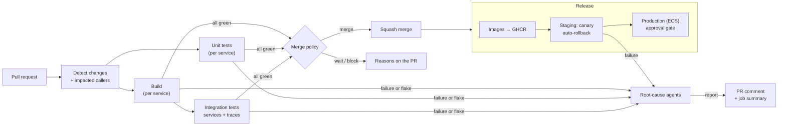
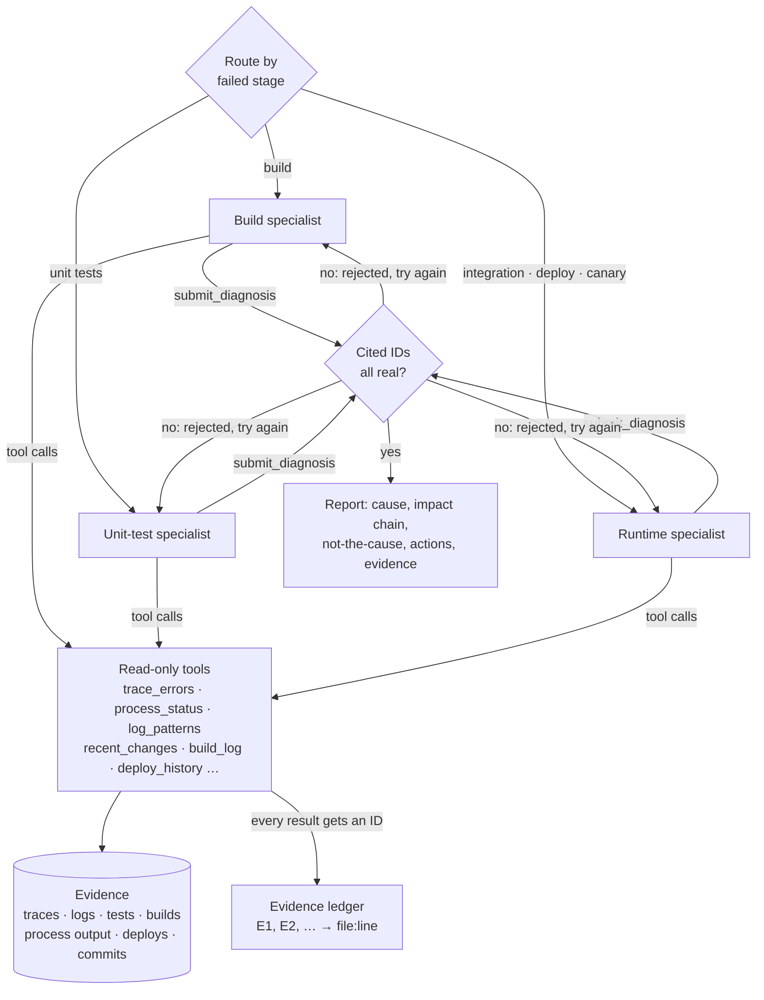

# Release Autopilot

[](https://github.com/10vin10-cmd/cicd-automation/actions/workflows/ci.yml)

CI/CD that runs itself and explains its own failures. Pull requests are built and tested selectively, merged automatically when policy allows, and deployed with canary analysis and automatic rollback. When something breaks, **root-cause agents** work out *which* service caused it and *why*, so nobody has to read the logs. They follow the failing calls through distributed traces from the service that reported the error to the one that caused it.

```
Root cause: payments — code regression
payments raises KeyError: 'amount' in POST /charges; changed in 4f9c2e1 "Rename amount_cents to amount in charge API"
Impact: orders → payments (the failure started in payments)
Not the cause: orders returned errors because calls to payments failed
```

The repo is a working demo. Three small services (`orders` calls `inventory` and `payments`) run through the real pipeline in GitHub Actions. Six fault scenarios reproduce real failure modes, and the agents are evaluated against them on every change.

> Independent, from-scratch implementation. No proprietary code or configuration.

---

## What it automates

| Stage | What happens | Code |
|---|---|---|
| **Change detection** | Maps changed files to services through the [service registry](services.yaml). Builds and unit-tests only those services, but runs integration tests for everything that *calls* them too. A change to shared code affects all services. | [`changes.py`](autopilot/changes.py) |
| **Build** | Resolves dependencies, compiles and builds the container image per changed service. The full log is kept as evidence. | [`ci.yml`](.github/workflows/ci.yml) |
| **Unit tests** | Run per service, in parallel, with JUnit output. | [`testing.py`](autopilot/testing.py) |
| **Integration tests** | Start the services as real processes with tracing on, then run checkout tests against the front door. Failed tests are retried once; a test that passes on retry is reported as **flaky**, not failed. | [`stack.py`](autopilot/stack.py) |
| **Auto-merge** | A policy decides merge, wait or block, and says why on the PR. Risky changes always wait for a person: workflows, infrastructure, shared code, or over 400 lines. Low-risk changes merge on green: docs, tests, dependency-bot bumps, or approved or `automerge`-labelled code. | [`merge_policy.py`](autopilot/merge_policy.py) |
| **Deploy** | Services deploy in dependency order. Each gets baseline and canary traffic, an error-rate and p95 comparison, then promote or **automatic rollback**. Callers aren't deployed on top of a failed dependency. Targets: a local stack (exercised by the demo pipeline) and **Amazon ECS** (new task definition, deployment circuit breaker, CloudWatch-alarm bake, rollback). | [`deploy/`](autopilot/deploy) |
| **Diagnosis** | On any failure or flake, agents investigate the collected evidence and post a root-cause report to the PR and the job summary. | [`doctor/`](autopilot/doctor) |



---

## How the root-cause agents work

Every pipeline run leaves an **evidence directory**:
- OpenTelemetry spans and structured logs from every service, joined by trace ID
- JUnit results, including retries
- raw process output (start-up crashes land here)
- stage results and build logs
- deploy history
- commits per service since the last good build

The agents only ever read this evidence. They never touch a live system.



**Cause, not symptom.** Each failed request's span tree is walked down to the deepest failing span, the one with no failing children ([`analysis.py`](autopilot/doctor/analysis.py)). That span says where the failure started and what kind it was:

| Deepest failing span | Conclusion |
|---|---|
| Server span with an exception | Code failed in that service (`KeyError: 'amount'`) |
| Client span, connection refused | The called service is down. Its process output usually says why (`KeyError: 'INVENTORY_DB_URL'` at start-up). |
| Client span, read timeout | The called service is too slow. Both sides are timed: payments took 2,503 ms, orders gave up at 1,000 ms. |
| Client span, 5xx, no server span | The called service failed but wasn't traced |

Every service above that span in the chain is reported as **not the cause**. Two easy mistakes are handled explicitly:
- OpenTelemetry marks client spans as errors on any 4xx, but a 409 "out of stock" is a correct answer, not a failure.
- Framework-internal spans are walked through but never blamed.

**Pluggable agents.** Set `AUTOPILOT_LLM` to `bedrock` (Amazon Bedrock Converse API) or `anthropic` (Anthropic Messages API), and `AUTOPILOT_LLM_MODEL` to the model ID. The model then chooses which tools to call and when it has enough evidence ([`agents.py`](autopilot/doctor/agents.py), [`llm.py`](autopilot/doctor/llm.py)). Without an LLM, the **offline playbook** runs the same tools in a fixed order and produces the same report shape. Both paths share the guardrails:

- **Cited evidence must exist.** Each tool result item gets a ledger ID tied to a file and line. A diagnosis citing an ID no tool returned is rejected, with the reason, so the model can correct itself. After repeated invalid answers, or no conclusion within the step budget, the playbook's answer is used and the report says so.
- **Specialists get only their tools.** A build failure doesn't need traces. Routing is deterministic and cheap; only the investigation is agentic.
- **Read-only, summarised tools.** Tools return failure chains, log *patterns* with counts, and compact span trees, never raw dumps. That keeps model context small and the tools usable by the playbook. Unknown arguments (a misspelled service) return an error instead of a misleading empty answer.
- **Transparent.** Every report includes the full list of tool calls made, and model token usage when a model was used.

### Evaluation

[`scenarios/`](scenarios) holds six failures. Five are reproduced for real: services started with an injected fault or with configuration withheld, real integration tests, and a real canary rollout. One replays a recorded pip dependency-conflict log. CI runs all six on every change ([`test_agent_eval.py`](tests/scenarios/test_agent_eval.py)):

| Scenario | What breaks | Expected | Playbook |
|---|---|---|---|
| [payments-schema-regression](docs/examples/payments-schema-regression.md) | payments renames a request field; orders fails with 502 | payments · code regression | ✅ 88% |
| [inventory-missing-config](docs/examples/inventory-missing-config.md) | inventory crashes on start-up without `INVENTORY_DB_URL`; orders gets connection refused | inventory · config error | ✅ 92% |
| [payments-latency](docs/examples/payments-latency.md) | payments takes 2.5 s; orders times out at 1 s | payments · latency | ✅ 80% |
| [payments-canary-rollback](docs/examples/payments-canary-rollback.md) | slow payments build reaches staging; canary fails; rolled back | payments · latency | ✅ 80% |
| [orders-flaky-warmup](docs/examples/orders-flaky-warmup.md) | first request after start-up fails, retry passes | orders · flaky test | ✅ 75% |
| [build-dependency-conflict](docs/examples/build-dependency-conflict.md) | a bump pins starlette below what fastapi needs | payments · build failure | ✅ 90% |

The playbook's rules were developed against these scenarios, so 6/6 shows the pipeline works end to end; it isn't a measure of generalisation. The same harness evaluates an LLM backend on the same failures:

```bash
AUTOPILOT_LLM=bedrock AUTOPILOT_LLM_MODEL=<model-id> autopilot scenario eval
```

---

## Design decisions

| Decision | Why |
|---|---|
| **Traces before logs** | Logs say *that* something failed; traces say *where in the call chain* it started. The span tree makes "orders fails because of payments" a structural fact rather than a guess from timestamps. |
| **Deterministic routing, agentic investigation** | Which specialist to use is obvious from the failed stage, so it costs no tokens. How to investigate depends on what the evidence shows, so that part is agentic. |
| **Evidence ledger** | The main risk with an LLM diagnosis is a confident, plausible, invented explanation. Requiring citations that resolve to real file:line evidence turns that risk into a validation error. |
| **One registry** | `services.yaml` drives impact analysis, deploy order, local ports and failure attribution, so they can't disagree. |
| **Integration tests for callers** | A change to payments can break orders without touching orders. Testing the callers catches contract breaks before merge. |
| **Flakes pass, but are reported** | A flake shouldn't block a release, but ignoring flakes is how real failures hide. Flakes are retried once, reported, and diagnosed. |
| **Dependency-ordered deploys that stop on failure** | Callers are never deployed against a dependency version that just failed its canary. |
| **Explicit release dispatch after auto-merge** | Merges made with the workflow token don't trigger push workflows, so the auto-merge job starts the release itself. |
| **Merge policy as code** | Every merge decision is explainable after the fact, and the policy is unit-tested like any other code. |

## Repository layout

```
services/                 orders, inventory, payments (FastAPI + OpenTelemetry), with unit tests
services.yaml             service registry: paths, ports, dependencies, owners
autopilot/
  changes.py              changed and impacted services, commits per service
  merge_policy.py         merge / wait / block with reasons
  stack.py                run services locally with faults; collect evidence
  testing.py              suites with retry and flaky detection
  deploy/                 canary analysis, local and ECS deployers with rollback
  doctor/                 evidence, analysis, tools + ledger, agents, LLM adapters, reports
  scenarios.py            reproduce failures and evaluate diagnoses
  cli.py                  `autopilot` command used by the workflows
scenarios/                six fault scenarios (+ one recorded build log)
tests/unit/               autopilot tests (agents run against a scripted model)
tests/integration/        checkout tests against the running stack
tests/scenarios/          agent evaluation
.github/workflows/        ci.yml (PRs) and release.yml (main → staging → production)
```

## Running it

```bash
pip install -e ".[dev]"

pytest                                   # 79 unit tests: autopilot + services
autopilot scenario eval --offline        # reproduce all six failures and diagnose them

autopilot stack up --fault payments=schema_v2      # break something yourself
autopilot test integration tests/integration --kind integration
autopilot stack down
autopilot diagnose --offline
```

**Use an LLM:**
- **Amazon Bedrock:** `AUTOPILOT_LLM=bedrock`, `AUTOPILOT_LLM_MODEL=<a Bedrock model ID that supports tool use>`, plus AWS credentials with `bedrock:InvokeModel`.
- **Anthropic API:** `AUTOPILOT_LLM=anthropic`, `AUTOPILOT_LLM_MODEL=<model ID>`, `ANTHROPIC_API_KEY`.

**In GitHub Actions**, set repository variables `AUTOPILOT_LLM` and `AUTOPILOT_LLM_MODEL`:
- For Bedrock, also set `AWS_ROLE_ARN` for an OIDC role.
- For the Anthropic API, add an `ANTHROPIC_API_KEY` secret.

Without these, the playbook runs. For production deploys, set `ECS_CLUSTER`, `AWS_ROLE_ARN` and `ECS_ALARM_PREFIX`, and add required reviewers to the `production` environment for an approval gate. Use **Release → Run workflow → bad_build** to ship a deliberately broken payments build and watch the canary roll it back and the agents explain why.

## Limitations

- Tested here: the LLM path is exercised with a scripted model, and the Bedrock and Anthropic adapters with fake clients. Run `scenario eval` with your model to measure it for real.
- The local deploy target restarts processes on the CI runner to demonstrate canary and rollback. The ECS deployer is tested against stubbed AWS APIs, not a live cluster.
- Faults are injected through environment variables, so the scenario commits are illustrative metadata, not real diffs.

## License

MIT
